

<h1>Sophy Studio</h1>

<b>Download it. Shape it. Tag it. Ship it.</b> 
The high-performance, all-in-one desktop & mobile audio toolkit for modern creators and music producers.

  <a href="#-----desktop--windows-"><b>🖥️ Desktop (Windows)</b></a>
  &nbsp;·&nbsp;
  <a href="#----mobile--android-"><b>📱 Mobile (Android)</b></a>
  &nbsp;·&nbsp;
  <a href="https://github.com/umwt26/Sophy-Studio/releases/latest"><b>Download Releases</b></a>
  &nbsp;·&nbsp;
  <a href="https://discord.gg/vwzjuhnpyP">Discord Community</a>
  &nbsp;·&nbsp;
  <a href="#made-by-beli">Made by Beli!</a>

<b>English</b> · <a href="README_TR.md">Türkçe</a> · <a href="README_DE.md">Deutsch</a> · <a href="README_FR.md">Français</a> · <a href="README_ES.md">Español</a> · <a href="README_PT.md">Português</a> · <a href="README_RU.md">Русский</a> · <a href="README_JA.md">日本語</a>

  
  
  
  
  

 

---

## 🖥️ Desktop Experience (Windows)

The desktop edition provides a distraction-free, sidebar-driven studio environment engineered with Tauri 2, Rust, and React 19. Every process runs directly on your PC with zero accounts, zero cloud delays, and zero audio quality loss.

 

### 1. Home Dashboard
All studio tools grouped into a logical workflow: Download, Create, and Edit & Analyze, accompanied by quick tips and a version changelog carousel.

  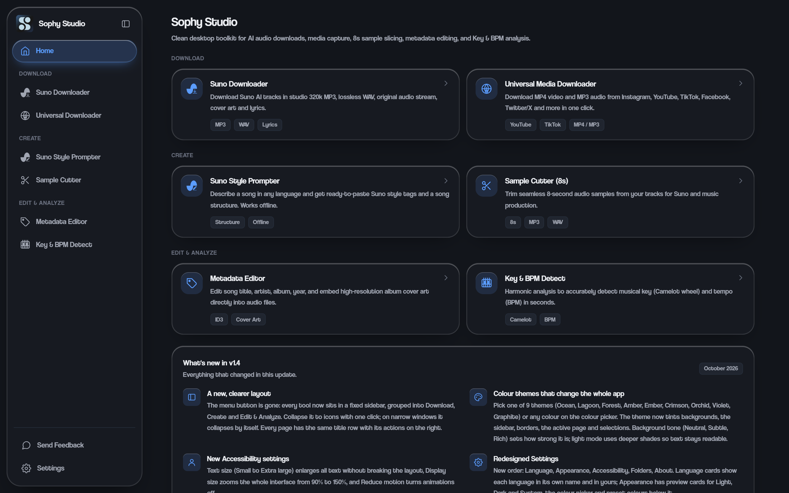

 

### 2. Suno Downloader 2.0
Paste any Suno song link to fetch studio 320 kbps MP3, lossless uncompressed WAV, or the raw source stream. High-res album artwork and synchronized lyrics (.lrc / .txt) are automatically extracted and embedded into the file. Includes a slide-over search history drawer with instant track reload.

  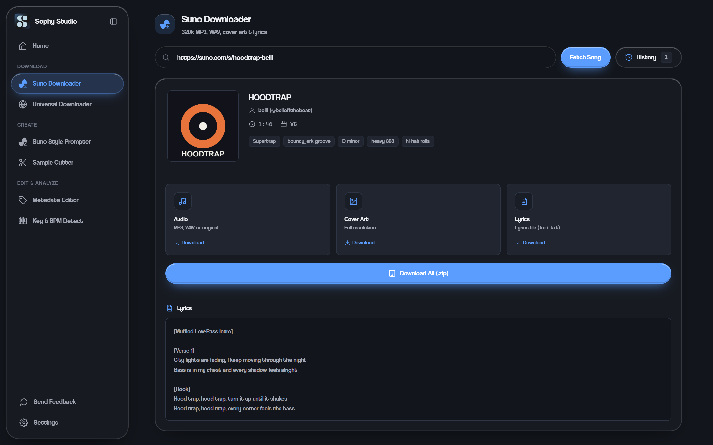

 

### 3. Universal Media Downloader
Grab video or audio from YouTube, Instagram, TikTok, Facebook, X (Twitter), Reddit, SoundCloud, Pinterest and hundreds of other platforms. Download as MP4 video or 320k MP3 audio with a single click. Keep track of all queries in a sortable, platform-filtered history.

  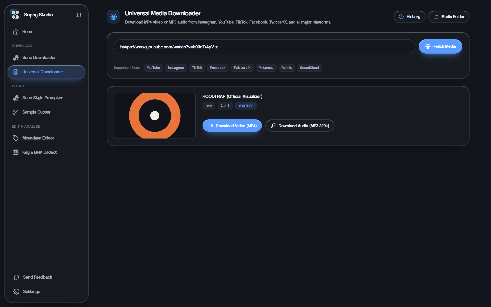

 

### 4. Suno Style Prompter
Describe your song in natural language, in any of 8 supported languages, and get ready-to-paste Style of Music tags (up to 1,000 characters) and structured arrangement sections (up to 5,000 characters) formatted with [Intro], [Verse], [Chorus], and [Outro]. Runs entirely offline with a multilingual rule engine and an integrated local llama.cpp AI model.

  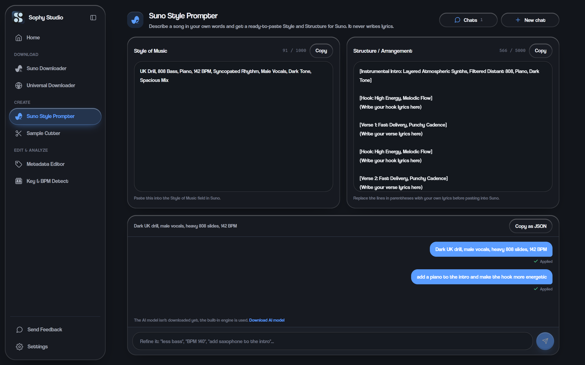

 

### 5. Sample Cutter (8s Waveform Slicer)
Load any audio track, slide an exact 8.0-second interactive loop window across the waveform, audition your slice with real-time playback, and export directly as 320k MP3 or lossless WAV. Specifically calibrated for Suno AI audio continuation uploads.

  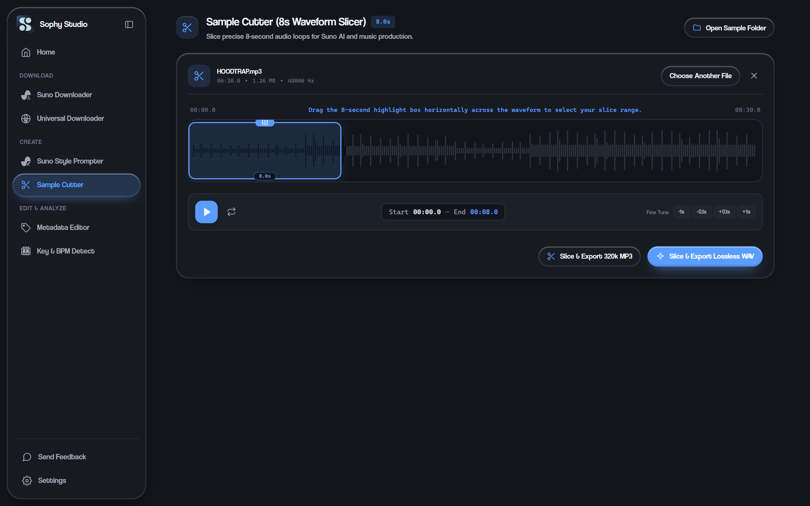

 

### 6. Audio Metadata Editor
View and edit track title, artist, album, year, genre, track number, and comments for MP3, WAV, FLAC, and M4A files. Writes native ID3v2.3 tags with embedded cover artwork that displays immediately in Windows Explorer, DJ software, and digital audio workstations.

  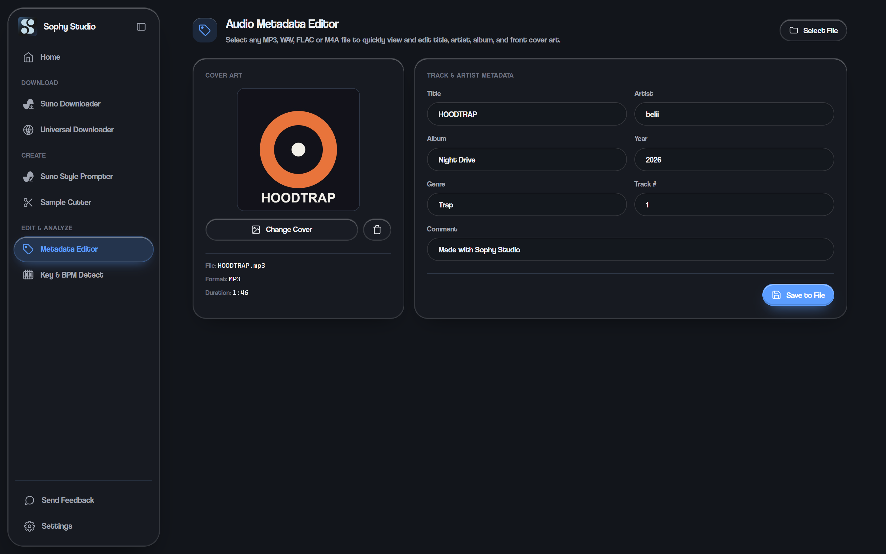

 

### 7. Musical Key & BPM Detection
Drop any audio file to identify its root musical key, Camelot Wheel position (e.g., 8B / C Major), compatible harmonic mixing keys for DJs, and exact tempo with precision nudge adjustments (-1, +1, /2, *2). Powered offline by Essentia.js WebAssembly.

  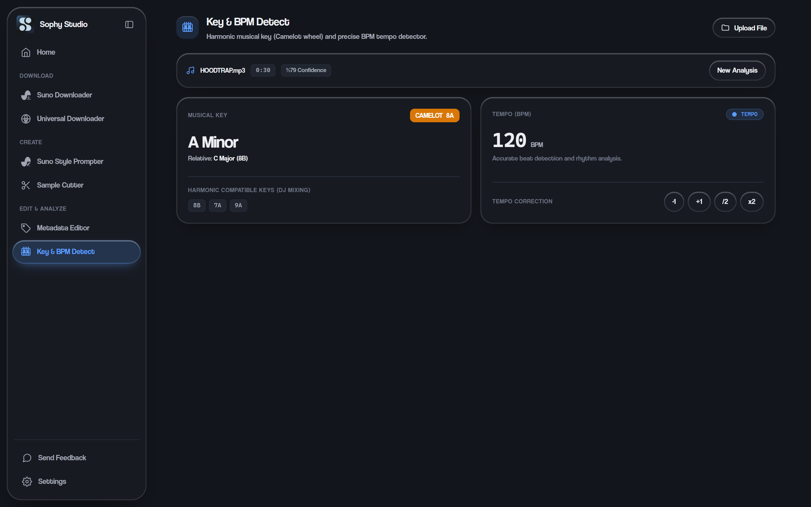

 

### 8. Desktop Settings & Personalization
Tailor Sophy Studio to your creative setup: 9 curated colour presets (Ocean, Lagoon, Forest, Amber, Ember, Crimson, Orchid, Violet, Graphite), an interactive 360° hex colour wheel, accessible text and display zoom scaling (90% to 150%), customizable output directories for each media type, and full 8-language localization.

  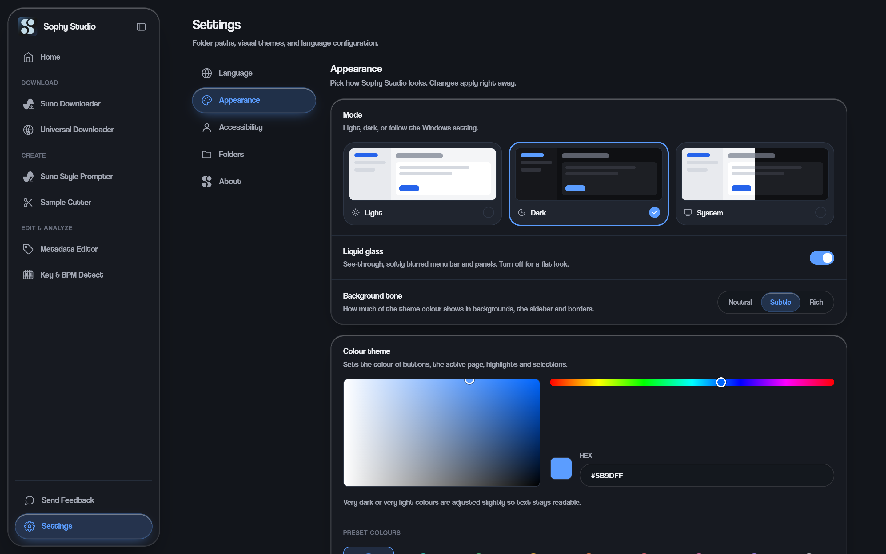

<table>
  <tr>
    <td width="50%">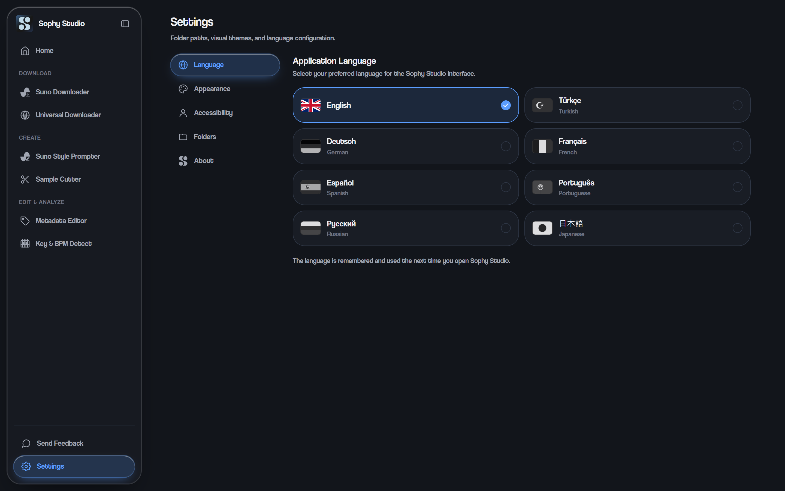</td>
    <td width="50%">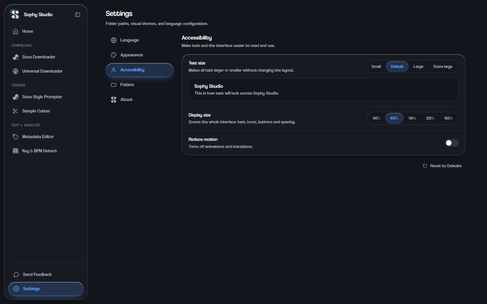</td>
  </tr>
  <tr>
    <td width="50%">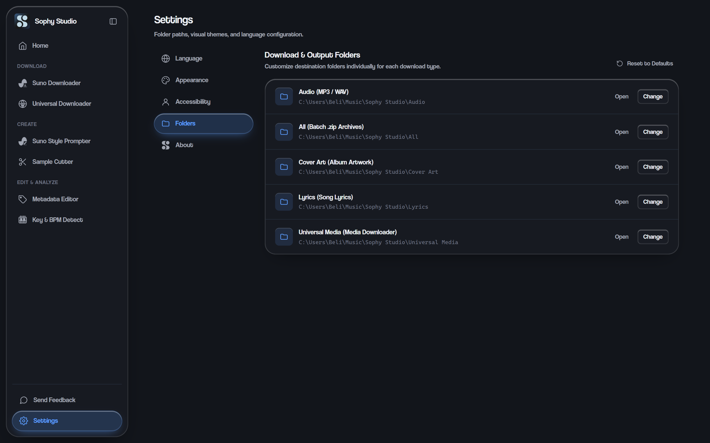</td>
    <td width="50%">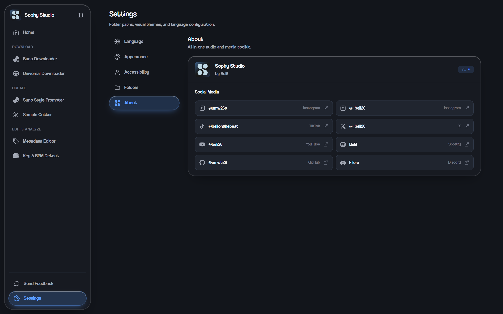</td>
  </tr>
</table>

 

#### 📥 Download Sophy Studio for Windows
1. Download **`Sophy_Studio_Setup.exe`** from the [Latest Release](https://github.com/umwt26/Sophy-Studio/releases/latest).
2. Run the installer. No administrative rights needed; installs cleanly for the current user and automatically cleans up legacy versions while preserving all user data and settings.
3. Launch from the Start menu or Desktop shortcut.

 

---

## 📱 Mobile Experience (Android)

Sophy Studio Mobile brings the complete desktop production suite to your smartphone, structured in the exact same logical order from Home to Settings, optimized for touch gestures, handheld ergonomics, and mobile workflows.

 

### 1. Mobile Home Dashboard
The handheld studio command center. Access all audio downloaders, creation tools, and analyzer features with clean tactile cards and instant navigation.

  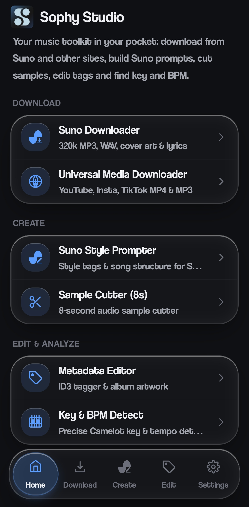

 

### 2. Suno Downloader Mobile
Download Suno tracks directly to your phone as studio 320k MP3, lossless WAV, original stream, artwork, or lyrics (.lrc / .txt) with full search history.

  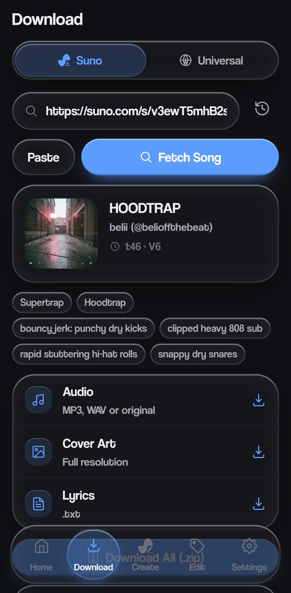

 

### 3. Universal Media Downloader & Share-to-Download
Download videos or audio from Instagram, TikTok, YouTube, X, Reddit and more. Plus, system-wide **Share-to-Download**: whenever you encounter a video in any app, tap Share -> Sophy Studio, and the download begins immediately!

  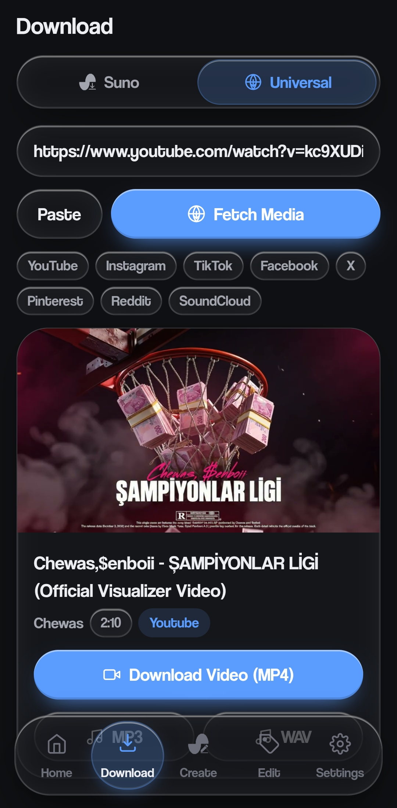

   
  <b>System-Wide Share-to-Download: share any video from social apps straight to Sophy Studio to download with 1 tap.</b>

 

### 4. Suno Style Prompter Mobile
Compose detailed Style of Music tags and structured arrangements directly on your phone with the smart multilingual rule engine and instrumental hints.

  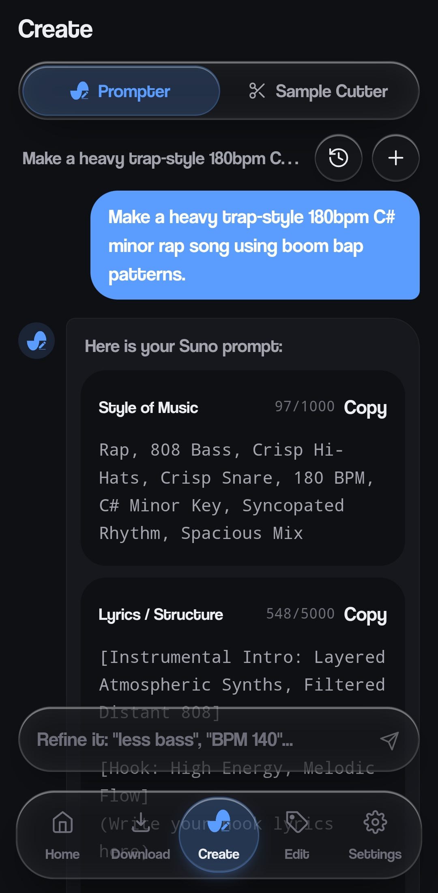

 

### 5. Sample Cutter Mobile
Slide an exact 8.0-second loop window across your track waveform on touch screen and export 320k MP3 or WAV slices for Suno continuation.

  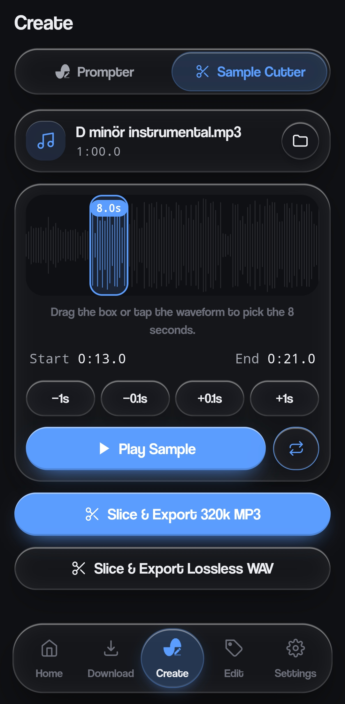

 

### 6. Audio Metadata Editor Mobile
Edit tags (title, artist, album, genre) and embed album artwork directly into audio files stored on your Android device.

  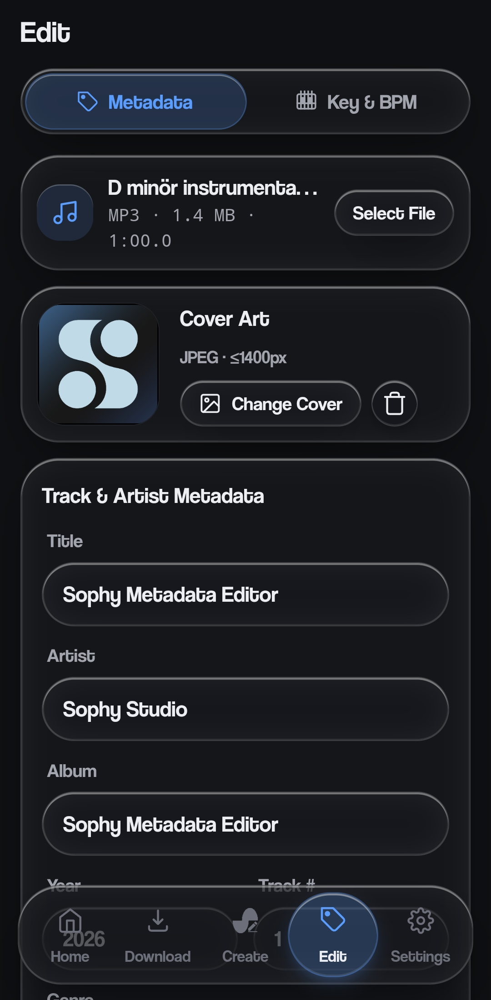

 

### 7. Key & BPM Detection Mobile
Analyze tracks on your phone offline: Camelot Wheel harmonic key notation, compatible harmonic pairs, and BPM tempo tracking.

  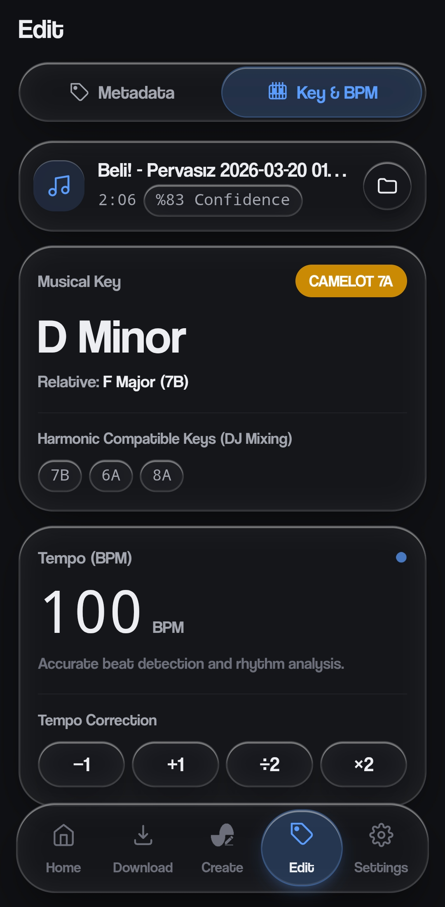

 

### 8. Mobile Settings & Liquid Glass Theme
Personalize your mobile experience: choose the exclusive fluid **Liquid Glass** theme with translucent glassmorphism, switch between 8 languages, and adjust accessible text/display scaling.

  

<table>
  <tr>
    <td width="33%">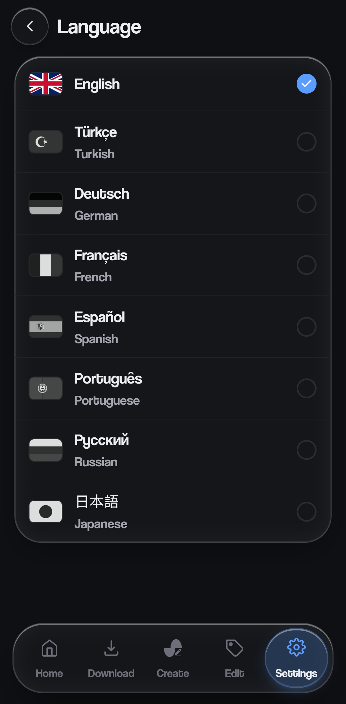</td>
    <td width="33%">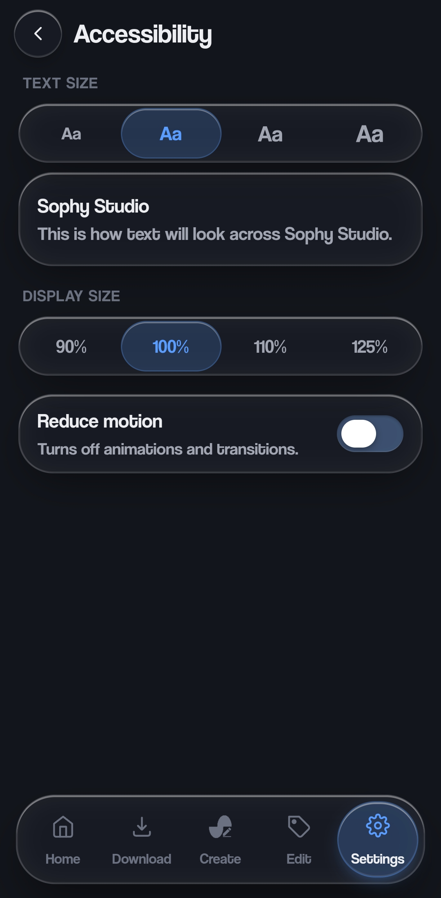</td>
    <td width="33%">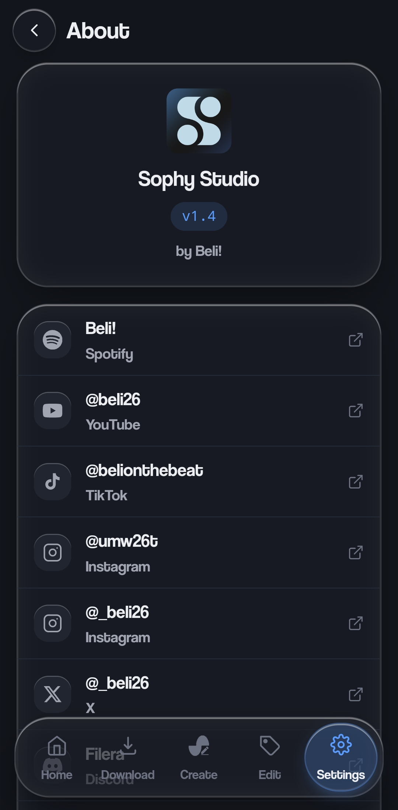</td>
  </tr>
</table>

 

#### 📥 Download Sophy Studio for Android
1. Download **`Sophy_Studio_Mobile_v1.4.0.apk`** from the [Latest Release](https://github.com/umwt26/Sophy-Studio/releases/latest).
2. Open the `.apk` on your Android device and confirm installation.
3. Open the app, or share any video link directly to Sophy Studio!

 

---

## 🛠️ Technology Stack / Architektur

| Component | Desktop (Windows) | Mobile (Android) |
|---|---|---|
| **Shell & Runtime** | Tauri 2 · Rust | Capacitor / Tauri Android |
| **Frontend UI** | React 19 · TypeScript · Tailwind CSS 4 · Vanilla CSS | React 19 · TypeScript · Touch Gestures |
| **Audio Processing** | FFmpeg · lofty / id3 · Essentia.js (WASM) | Web Audio API · Essentia.js (WASM) |
| **Download Engine** | Native Suno Client · yt-dlp binary | Suno API Client · Extractor Service |
| **Offline AI Model** | llama.cpp · Qwen2.5-1.5B-Instruct (Q4_K_M) | Multilingual Natural Language Rule Engine |
| **Packaging** | NSIS Per-User Installer (`.exe`) | Android Package (`.apk`) |

 

---

## 🎵 Made by Beli!

Sophy Studio is crafted, designed, and maintained by **Beli!** — an independent music producer, rap artist, and software developer.

<table>
  <tr>
    <td valign="top" width="33%">
      <b>🎧 Listen</b>  
      <a href="https://open.spotify.com/artist/0abGcEf1RCkROklu9iYoR7">Spotify · Beli!</a> 
      <a href="https://www.youtube.com/@beli26">YouTube · @beli26</a> 
      <a href="https://www.tiktok.com/@belionthebeat">TikTok · @belionthebeat</a>
    </td>
    <td valign="top" width="33%">
      <b>📱 Connect</b>  
      <a href="https://www.instagram.com/umw26t/">Instagram · @umw26t</a> 
      <a href="https://www.instagram.com/_beli26/">Instagram · @_beli26</a> 
      <a href="https://x.com/_beli26">X (Twitter) · @_beli26</a>
    </td>
    <td valign="top" width="33%">
      <b>💬 Community &amp; Support</b>  
      <a href="https://discord.gg/vwzjuhnpyP">Discord Server · Filera</a> 
      <a href="https://github.com/umwt26">GitHub · @umwt26</a> 
      <a href="https://github.com/umwt26/Sophy-Studio/issues">Report an Issue</a>
    </td>
  </tr>
</table>

Supported by [Filerawave](https://www.filerawave.com) & [Filera Music](https://www.filera.page).

 

---

## 📄 License

This project is licensed under the **MIT License** — see the [LICENSE](LICENSE) file for details.
