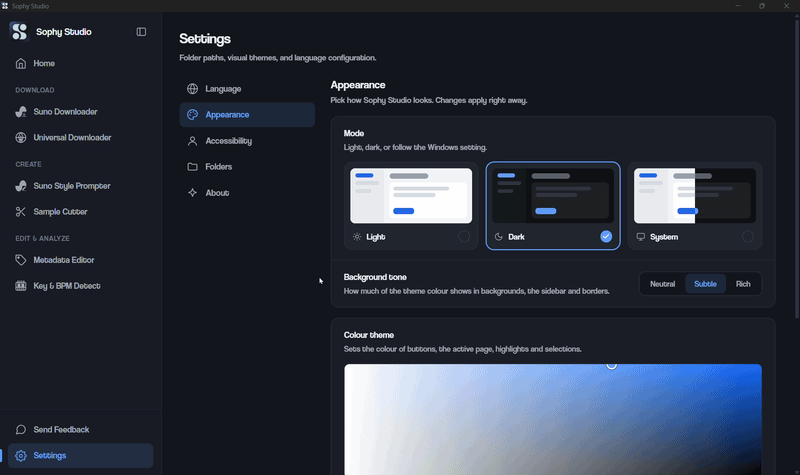

<h1>Sophy Studio</h1>

<b>İndir. Şekillendir. Etiketle. Yayınla.</b> 
Modern müzik üreticileri ve içerik üreticileri için yüksek performanslı, hepsi bir arada masaüstü ve mobil ses stüdyosu.

  <a href="#-----masa-st---windows-"><b>🖥️ Masaüstü (Windows)</b></a>
  &nbsp;·&nbsp;
  <a href="#----mobil--android-"><b>📱 Mobil (Android)</b></a>
  &nbsp;·&nbsp;
  <a href="https://github.com/umwt26/Sophy-Studio/releases/latest"><b>Sürümleri İndir</b></a>
  &nbsp;·&nbsp;
  <a href="https://discord.gg/vwzjuhnpyP">Discord Topluluğu</a>
  &nbsp;·&nbsp;
  <a href="#made-by-beli">Beli! Tarafından Yapıldı</a>

<a href="README.md">English</a> · <b>Türkçe</b> · <a href="README_DE.md">Deutsch</a> · <a href="README_FR.md">Français</a> · <a href="README_ES.md">Español</a> · <a href="README_PT.md">Português</a> · <a href="README_RU.md">Русский</a> · <a href="README_JA.md">日本語</a>

  
  
  
  
  

 

---

## 🖥️ Masaüstü Deneyimi (Windows)

Masaüstü sürümü, Tauri 2, Rust ve React 19 ile sıfırdan geliştirilmiş, dikkat dağıtmayan, yan menülü eksiksiz bir stüdyo ortamı sunar. Tüm işlemler hesap gerektirmeden, bulut gecikmesi olmadan ve ses kalitesinden ödün vermeden doğrudan bilgisayarınızda yerel çalışır.

 

### 1. Ana Sayfa Kontrol Paneli
Tüm stüdyo araçları mantıksal bir iş akışıyla gruplanmıştır: İndir, Üret ve Düzenle & Analiz Et. Hızlı kullanım ipuçları ve sürüm notları karuseli eşlik eder.

  

 

### 2. Suno Downloader 2.0
Herhangi bir Suno şarkı bağlantısını yapıştırarak stüdyo kalitesinde 320 kbps MP3, kayıpsız sıkıştırılmamış WAV veya ham ses akışını indirin. Yüksek çözünürlüklü albüm kapağı ve senkronize şarkı sözleri (.lrc / .txt) otomatik olarak çıkartılıp dosyaya gömülür. Geçmiş şarkılarınıza tek tıkla dönmenizi sağlayan açılır arama geçmişi çekmecesini içerir.

  

 

### 3. Evrensel Medya İndirici (Universal Downloader)
YouTube, Instagram, TikTok, Facebook, X (Twitter), Reddit, SoundCloud, Pinterest ve yüzlerce platformdan video veya ses yakalayın. Tek tıkla MP4 video veya 320k MP3 ses seçimi yapın. Filtrelenebilir ve sıralanabilir indirme geçmişi sunar.

  

 

### 4. Suno Style Prompter
Aklınızdaki şarkıyı kendi cümlelerinizle 8 dilden birinde ifade edin; Suno AI için doğrudan kopyalanabilir Style of Music etiketleri (1.000 karaktere kadar) ve [Intro], [Verse], [Chorus], [Drop], [Outro] düzeninde şarkı yapısı şablonları (5.000 karaktere kadar) edinin. Çok dilli kural motoru ve entegre yerel llama.cpp yapay zekasıyla tamamen çevrimdışı çalışır.

  

 

### 5. Sample Kesici (8 Saniyelik Dalga Boyu Dilimleyici)
Herhangi bir ses parçasını yükleyin, 8.0 saniyelik sabit döngü penceresini dalga boyu üzerinde kaydırın, gerçek zamanlı önizleme yapın ve 320k MP3 ya da kayıpsız WAV olarak dışa aktarın. Suno AI ses devam ettirme yüklemeleri için hassas olarak ayarlanmıştır.

  

 

### 6. Ses Metadata Editörü
MP3, WAV, FLAC ve M4A dosyalarının başlık, sanatçı, albüm, yıl, tür, parça numarası ve açıklamalarını düzenleyin. Albüm kapağını ID3v2.3 standartlarında doğrudan dosyaya gömer; kapak Windows Gezgini'nde, DJ yazılımlarında ve DAW programlarında anında görünür.

  

 

### 7. Müzikal Ton (Key) & BPM Tespiti
Herhangi bir ses dosyasını sürükleyip bırakarak parça tonunu, Camelot çarkındaki konumunu (örn. 8B / Do Majör), DJ'ler için uyumlu miks tonlarını ve kesin tempo değerini tespit edin. Tempo çarpanlarıyla (-1, +1, /2, *2) ince ayar yapabilirsiniz. Essentia.js WebAssembly ile tamamen çevrimdışı analiz eder.

  

 

### 8. Masaüstü Ayarları & Kişiselleştirme
Sophy Studio'yu yaratıcı çalışma ortamınıza uyarlayın: 9 dinamik renk teması, 360° renk tekerleği, düzeni bozmadan Küçük'ten Çok Büyük'e metin/ekran ölçekleme (%90 - %150), her medya türü için ayrı çıktı klasörleri ve 8 dil desteği.

  

<table>
  <tr>
    <td width="50%"></td>
    <td width="50%"></td>
  </tr>
  <tr>
    <td width="50%"></td>
    <td width="50%"></td>
  </tr>
</table>

 

#### 📥 Windows İçin İndir
1. En Son Sürüm sayfasından **`Sophy_Studio_Setup.exe`** dosyasını indirin.
2. Kurulumu çalıştırın. Yönetici yetkisi gerektirmez; geçerli kullanıcı için temiz kurulum yapar ve verilerinize dokunmadan eski sürümleri otomatik temizler.
3. Başlat menüsünden veya masaüstü kısayolundan başlatın.

 

---

## 📱 Mobil Deneyimi (Android)

Sophy Studio Mobil, masaüstündeki eksiksiz prodüksiyon araç setini akıllı telefonunuza taşır; Ana Sayfadan başlayarak Ayarlara kadar aynı mantıksal sıralamayla, dokunmatik hareketler ve tek elle kullanım ergonomisine özel olarak optimize edilmiştir.

 

### 1. Mobil Ana Sayfa Kontrol Paneli
Taşınabilir stüdyo komuta merkeziniz. Tüm indiricilere, üretim araçlarına ve analiz modüllerine dokunmatik kartlarla anında erişin.

  

 

### 2. Mobil Suno Downloader
Suno şarkılarını doğrudan telefonunuza stüdyo 320k MP3, kayıpsız WAV, orijinal akış, kapak ve şarkı sözleri (.lrc / .txt) formatlarında tek tıkla indirin.

  

 

### 3. Evrensel Medya İndirici & Sistem Paylaşımı ile İndirme (Share-to-Download)
Instagram, TikTok, YouTube, X ve Reddit'ten video veya ses indirin. Üstelik **Doğrudan Paylaş ve İndir**: sosyal medyada gezinirken Paylaş -> Sophy Studio seçtiğiniz an indirme hemen başlar!

  

   
  <b>Sistem Paylaşım Entegrasyonu: sosyal medya videolarını doğrudan Sophy Studio ile paylaşarak tek dokunuşla indirin.</b>

 

### 4. Mobil Suno Style Prompter
Doğal dille akıllı kural motorunu kullanarak telefonunuzda detaylı Style of Music etiketleri ve şarkı düzen şablonları hazırlayın.

  

 

### 5. Mobil Sample Kesici
Dokunmatik ekranda 8.0 saniyelik sabit döngü penceresini dalga boyu üzerinde kaydırın ve Suno devam ettirme için anında MP3/WAV parçalar kesin.

  

 

### 6. Mobil Ses Metadata Editörü
Telefonunuzdaki ses dosyalarının ID3 etiketlerini düzenleyin ve albüm kapaklarını doğrudan ses dosyasına gömün.

  

 

### 7. Mobil Key & BPM Tespiti
Parçalarınızı telefonunuzda tamamen çevrimdışı analiz edin: Camelot nota gösterimi, uyumlu miks tonları ve hassas BPM tempo tespiti.

  

 

### 8. Mobil Ayarlar & Liquid Glass Teması
Mobil deneyiminizi kişiselleştirin: özel akışkan **Liquid Glass** temasını seçin, 8 dil arasında geçiş yapın ve dokunmatik erişilebilirlik boyutlarını ayarlayın.

  

<table>
  <tr>
    <td width="33%"></td>
    <td width="33%"></td>
    <td width="33%"></td>
  </tr>
</table>

 

#### 📥 Android İçin İndir
1. En Son Sürüm sayfasından **`Sophy_Studio_Mobile_v1.4.0.apk`** dosyasını indirin.
2. Telefonunuzda APK dosyasını açıp yüklemeyi onaylayın.
3. Uygulamayı açın ya da Instagram, TikTok veya YouTube'da herhangi bir videoda **Paylaş**'a basıp **Sophy Studio**'yu seçin!

 

---

## 🛠️ Technology Stack / Architektur

| Component | Desktop (Windows) | Mobile (Android) |
|---|---|---|
| **Shell & Runtime** | Tauri 2 · Rust | Capacitor / Tauri Android |
| **Frontend UI** | React 19 · TypeScript · Tailwind CSS 4 · Vanilla CSS | React 19 · TypeScript · Touch Gestures |
| **Audio Processing** | FFmpeg · lofty / id3 · Essentia.js (WASM) | Web Audio API · Essentia.js (WASM) |
| **Download Engine** | Native Suno Client · yt-dlp binary | Suno API Client · Extractor Service |
| **Offline AI Model** | llama.cpp · Qwen2.5-1.5B-Instruct (Q4_K_M) | Multilingual Natural Language Rule Engine |
| **Packaging** | NSIS Per-User Installer (`.exe`) | Android Package (`.apk`) |

 

---

## 🎵 Made by Beli!

Sophy Studio is crafted, designed, and maintained by **Beli!** — an independent music producer, rap artist, and software developer.

<table>
  <tr>
    <td valign="top" width="33%">
      <b>🎧 Listen</b>  
      <a href="https://open.spotify.com/artist/0abGcEf1RCkROklu9iYoR7">Spotify · Beli!</a> 
      <a href="https://www.youtube.com/@beli26">YouTube · @beli26</a> 
      <a href="https://www.tiktok.com/@belionthebeat">TikTok · @belionthebeat</a>
    </td>
    <td valign="top" width="33%">
      <b>📱 Connect</b>  
      <a href="https://www.instagram.com/umw26t/">Instagram · @umw26t</a> 
      <a href="https://www.instagram.com/_beli26/">Instagram · @_beli26</a> 
      <a href="https://x.com/_beli26">X (Twitter) · @_beli26</a>
    </td>
    <td valign="top" width="33%">
      <b>💬 Community &amp; Support</b>  
      <a href="https://discord.gg/vwzjuhnpyP">Discord Server · Filera</a> 
      <a href="https://github.com/umwt26">GitHub · @umwt26</a> 
      <a href="https://github.com/umwt26/Sophy-Studio/issues">Report an Issue</a>
    </td>
  </tr>
</table>

Supported by [Filerawave](https://www.filerawave.com) & [Filera Music](https://www.filera.page).

 

---

## 📄 License

This project is licensed under the **MIT License** — see the [LICENSE](LICENSE) file for details.
