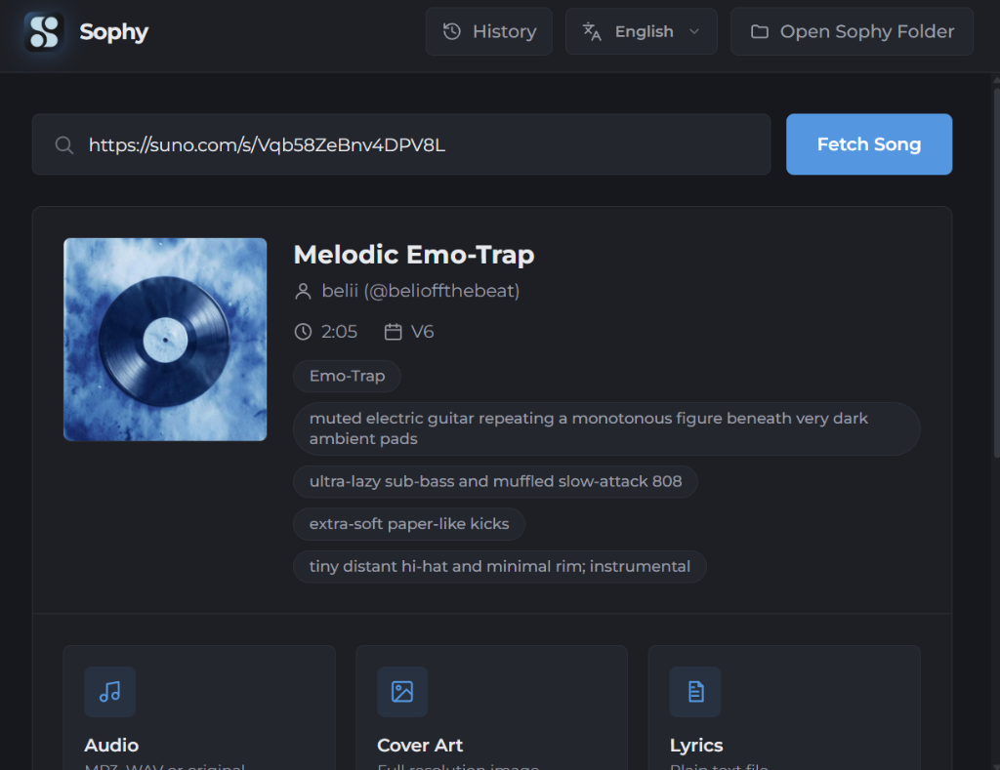
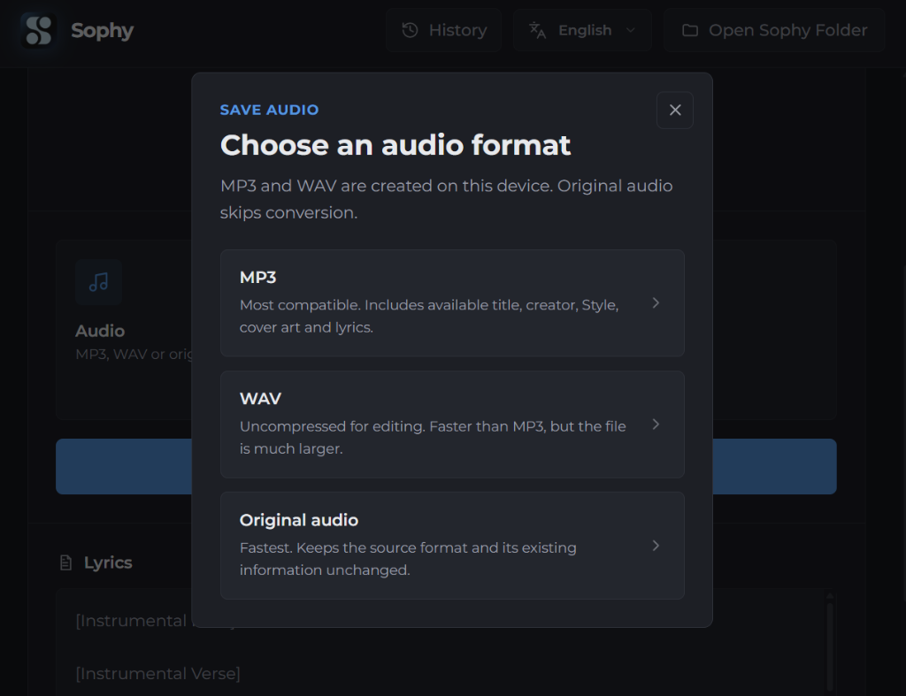
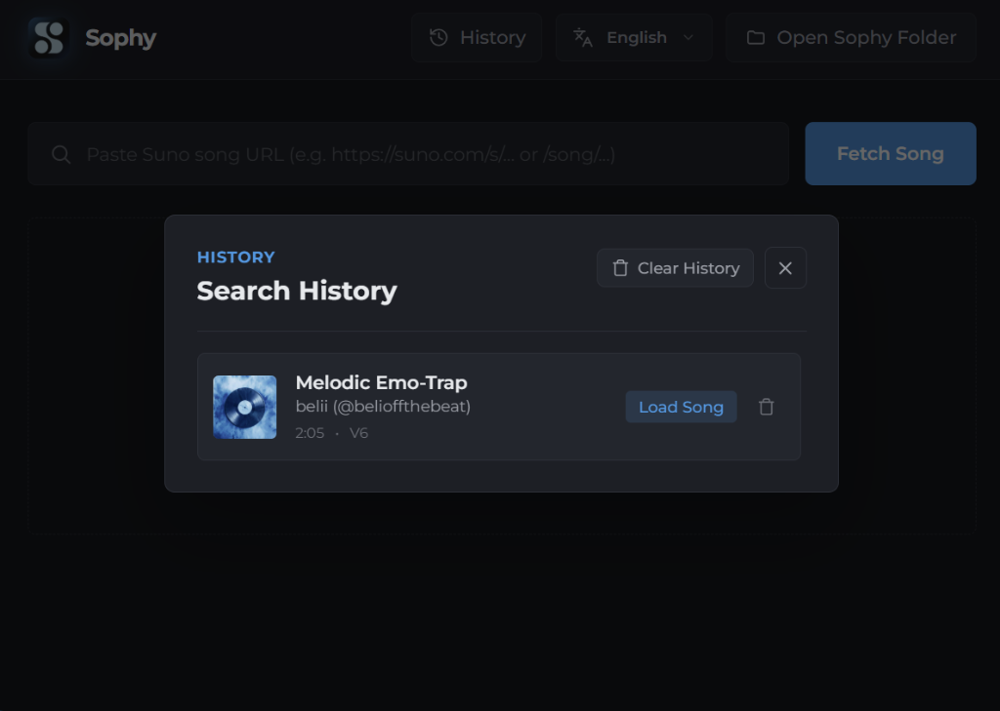
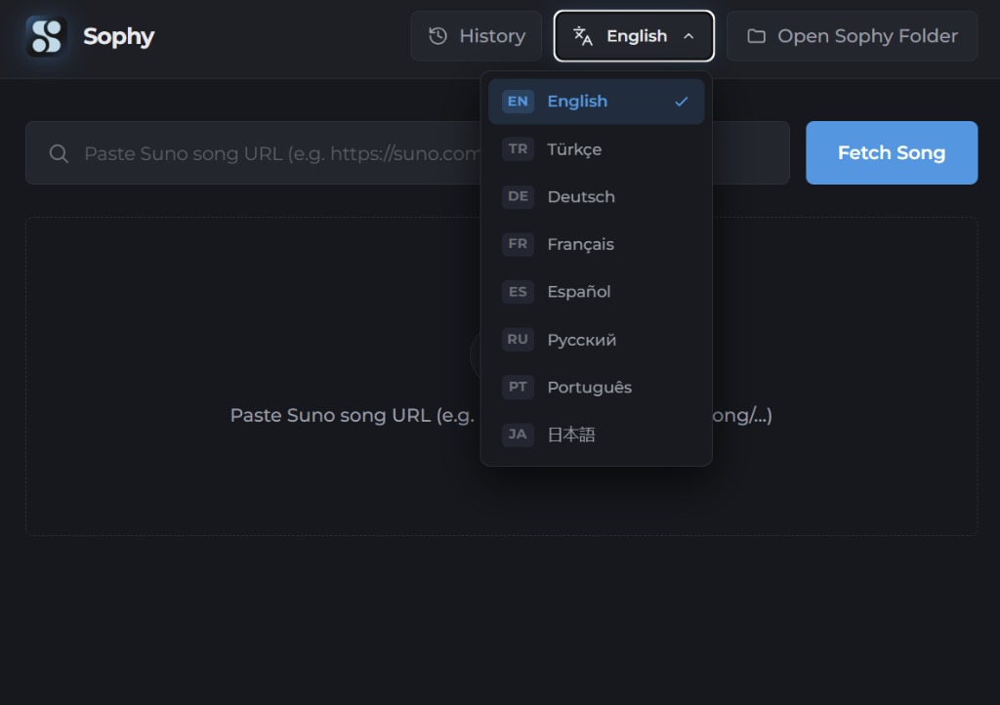
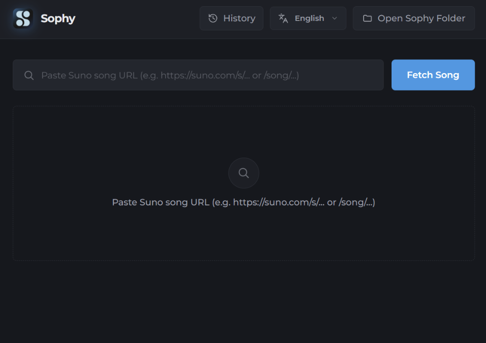

# 🎵 Sophy — Suno İndirici & Araç Seti

**Suno AI Medyaları İçin Yeni Nesil, Yüksek Performanslı Masaüstü İndirme Aracı.**

[-E4405F.svg?style=for-the-badge&logo=instagram)](https://www.instagram.com/umw26t/)

 

🌐 **Dil / Language:** [English](README.md) | **Türkçe**

---

## 💡 Sophy Hakkında

> **Suno'nun indirme limitlerinden, kota engellerinden ve hantal web arayüzlerinden sıkıldıysanız buyurun canlar, işler artık çocuk oyuncağı!**  
> Sophy; müzik üreticileri, dinleyiciler ve içerik üreticileri için tasarlandı. İstediğiniz herhangi bir Suno şarkı bağlantısını yapıştırın; tek tıkla stüdyo kalitesinde 320kbps MP3, DAW için kayıpsız uncompressed WAV, orijinal yüksek çözünürlüklü kapak görseli ve şarkı sözlerini anında bilgisayarınıza indirin. Ücretsiz, sınırsız ve ışık hızında!

---

## ✨ Öne Çıkan Özellikler

- **⚡ Anında Şarkı Analizi:** Herhangi bir Suno linkini (`suno.com/s/...`, `suno.com/song/...` veya şarkı UUID kodu) yapıştırın; 1 saniyeden kısa sürede tüm etiketleri, model sürümünü, sanatçı adını ve şarkı sözlerini getirin.
- **🎧 Stüdyo Kalitesinde Ses Formatları:**
  - **MP3 (320 kbps)** — Şarkı adı, sanatçı, tür/stil ve kapak görseli ID3 etiketlerine gömülmüş yüksek kaliteli ses.
  - **WAV (Lossless 44.1 kHz 16-bit)** — FL Studio, Ableton, Logic Pro vb. prodüksiyon programlarına doğrudan aktarabileceğiniz stüdyo kayıpsız ses.
  - **Orijinal Ses** — Suno'dan gelen saf akışı format değiştirmeden doğrudan indirme.
- **📦 Tümünü İndir (.zip):** 320kbps MP3 sesini, yüksek çözünürlüklü kapak görselini (.jpg) ve şarkı sözlerini (.txt) tek bir tıklamayla şık bir `.zip` paketi halinde indirin.
- **🕒 Arama Geçmişi:** Tarattığınız şarkılar kaybolmaz! Yerel geçmiş listesinden istediğiniz önceki şarkıyı tek tıkla tekrar ekrana yükleyin.
- **🌍 8 Farklı Dil Desteği:** Türkçe, İngilizce, Almanca, Fransızca, İspanyolca, Rusça, Portekizce ve Japonca dilleri arasında canlı geçiş yapın.
- **🔕 %100 Sessiz Çalışma:** Ekranda aniden fırlayan sinir bozucu siyah terminal/komut istemi pencereleri yoktur; tüm dönüştürme işlemleri arka planda sessizce yürütülür.
- **🚀 Uzaktan Güncelleme Kontrolcüsü:** Yeni bir sürüm çıktığında GitHub Releases üzerinden sistemi otomatik algılar ve sizi uyarır ("Aa yeni sürüm var, hadi güncelle beni!").
- **📁 Düzenli Klasör Mimarisi:** İndirmeleriniz `Belgeler\Sophy\` altında otomatik olarak kategorize edilir (`Audio`, `Cover Art`, `Lyrics`, `All`).

---

## 📸 Ekran Görüntüleri

### 1. Şarkı Detayları & İndirme Seçenekleri
Şarkının stilini, prompt etiketlerini ve model sürümünü inceleyin; istediğiniz formatta indirmeyi başlatın:

  

 

### 2. Ses Formatı Seçimi (MP3 320k / WAV Kayıpsız / Orijinal)
İster günlük dinleme için MP3, ister müzik prodüksiyonu için kayıpsız WAV seçin:

  

 

### 3. Arama Geçmişi Modalı
Daha önce tarattığınız şarkılara geçmişten hemen ulaşın veya dilediğinizde geçmişi temizleyin:

  

 

### 4. Çoklu Dil Desteği (8 Dil)
Uygulama dilini tek tıkla dilediğiniz gibi değiştirin:

  

 

### 5. Sade ve Modern Ana Ekran
Göz yormayan karanlık tema ile tasarlanmış modern karşılama ekranı:

  

---

## 📥 Kurulum

### Windows Kurulum Sihirbazı (Setup)
1. En güncel `Sophy_Setup.exe` dosyasını [Releases](https://github.com/umwt26/sophy-suno-downloader/releases) sayfasından indirin.
2. Kurulum sihirbazını çalıştırarak kolayca kurulumu tamamlayın.
3. Masaüstündeki veya Başlat Menüsündeki **Sophy** simgesine tıklayarak hemen kullanmaya başlayın!

---

## 🛠️ Teknoloji Yığını

| Katman | Kullanılan Teknolojiler |
| :--- | :--- |
| **Masaüstü Shell** | [Tauri 2](https://v2.tauri.app) + [Rust](https://www.rust-lang.org/) |
| **Arayüz (Frontend)** | [React 19](https://react.dev/), [TypeScript](https://www.typescriptlang.org/), [Tailwind CSS v4](https://tailwindcss.com/) |
| **Medya Motoru** | Özel Rust şifre çözme motoru & [FFmpeg](https://ffmpeg.org/) (sessiz mod) |
| **Kurulumcu** | Özelleştirilmiş NSIS 3.x Modern UI |

---

## 🧑‍💻 Geliştirici

**Beli! (Umut)** tarafından sevgiyle geliştirildi.

- 📸 **Instagram:** [@umw26t](https://www.instagram.com/umw26t/)
- 🌐 **GitHub:** [umwt26](https://github.com/umwt26)

---

## 📄 Lisans & Yasal Uyarı

Bu proje MIT Lisansı altında sunulmaktadır.  
*Yasal Uyarı: Sophy bağımsız bir açık kaynak araç setidir; Suno AI ile resmi bir bağı veya ortaklığı bulunmamaktadır. Sanatçıların ve platformların telif haklarına lütfen özen gösteriniz.*
